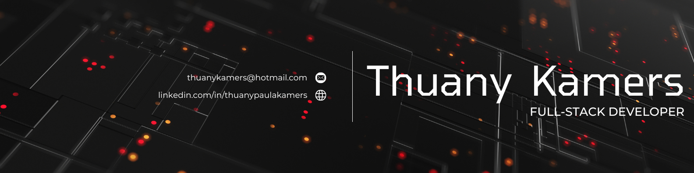

  

🌐 **Portfolio:** https://thuanykamers.github.io/portfolio/

## Tech Stack

### Frontend

 

 

### Backend

 

 

### Banco de Dados

 

 

### Ferramentas & DevOps

 

 

Junior developer with a Bachelor's degree in Information Systems. I build web applications with PHP, React and TypeScript.

## Currently

- Studying cybersecurity
- Looking for an IT role in Europe
