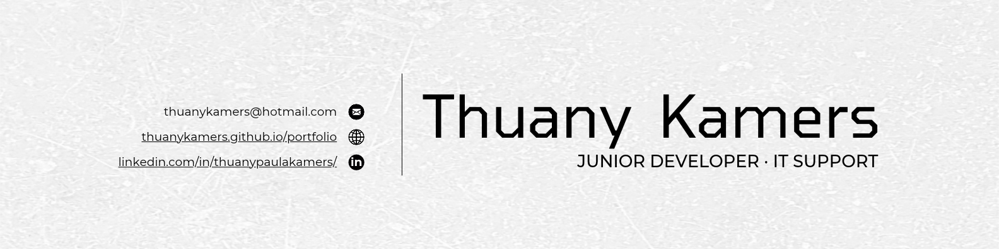

## Tech Stack

### Frontend

<table>
  <tr>
    <td align="center"> HTML5</td>
    <td align="center"> CSS3</td>
    <td align="center"> JavaScript</td>
    <td align="center"> TypeScript</td>
    <td align="center"> React</td>
    <td align="center"> Tailwind CSS</td>
  </tr>
</table>

### Backend

<table>
  <tr>
    <td align="center"> PHP</td>
    <td align="center"> Python</td>
    <td align="center"> Node.js</td>
    <td align="center"> Express</td>
  </tr>
</table>

### Mobile

<table>
  <tr>
    <td align="center"> Dart</td>
    <td align="center"> Flutter</td>
    <td align="center"> Lua</td>
  </tr>
</table>

### Databases

<table>
  <tr>
    <td align="center"> MySQL</td>
    <td align="center"> PostgreSQL</td>
  </tr>
</table>

### Tools & DevOps

<table>
  <tr>
    <td align="center"> Git</td>
    <td align="center"> GitHub</td>
    <td align="center"> Docker</td>
    <td align="center"> Vite</td>
    <td align="center"> Windows</td>
    <td align="center"> Linux</td>
    <td align="center"> XAMPP</td>
    <td align="center"> GSAP</td>
  </tr>
</table>

## Currently

- Studying cybersecurity
- Looking for an IT role in Europe

## Contact

**Portfolio:** https://thuanykamers.github.io/portfolio/

<table>
  <tr>
    <td align="center"> LinkedIn</td>
    <td align="center"> Instagram</td>
    <td align="center"> Email</td>
  </tr>
</table>
